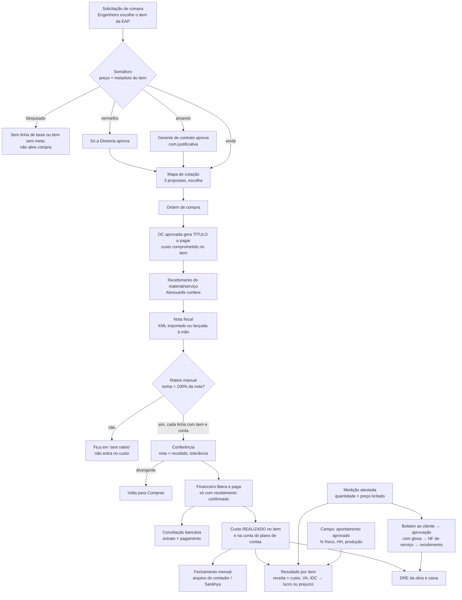

# Fluxo da nota fiscal (do pedido à medição)

Regras que o sistema trava: obra sem linha de base não compra (E01); nota sem rateio não vira custo; rateio ≠ 100% não grava; chave de NF-e repetida é recusada; pagamento só com recebimento; quem lança não aprova; medido não passa do orçado; tudo fica na auditoria.
